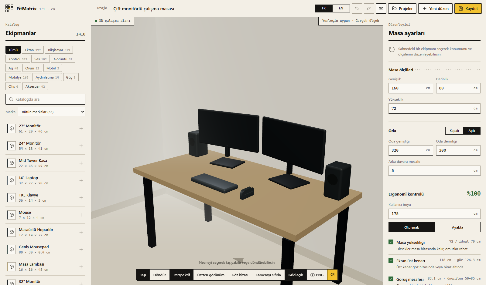

# FitMatrix

[](https://github.com/kursatcnk/FitMatrix/actions/workflows/ci.yml)

FitMatrix, masaüstü bilgisayar kurulumlarını gerçek fiziksel ölçülerle 3D ortamda planlamak için geliştirilen bir web uygulamasıdır.



> **English:** FitMatrix is a 3D desk setup planner that works in real centimetres. Pick monitors, keyboards, mice, laptops, chairs and more from a catalog of 1,100+ products whose dimensions come from manufacturers' own pages, place them on your desk with collision checks, and get an ergonomics score for your height. Run it with `docker compose up --build` and open http://localhost:8080.

## Docker ile çalıştırma

Windows, macOS veya Linux'ta tek komut yeterlidir; SQL Server, API ve editör birlikte açılır:

```bash
docker compose up --build
```

Ardından http://localhost:8080 adresini aç. İlk açılışta veritabanı oluşturulur ve depodaki katalog anlık görüntüsü (`backend/Data/Catalog/catalog-snapshot.json`) yüklenir; editör 1.100'den fazla ölçüsü doğrulanmış ürünle başlar. Veritabanı `fitmatrix-sql` Docker biriminde kalıcıdır. Geliştirme parolasını veya portu değiştirmek için `.env.example` dosyasını `.env` olarak kopyalayıp düzenle. Apple Silicon Mac'lerde SQL Server imajı Docker Desktop'ın Rosetta emülasyonuyla çalışır.

## Yerel sürüm durumu

Yerel kullanım için tamamlanan uygulama:

- React, TypeScript ve Vite tabanlı frontend
- React Three Fiber ile gerçek zamanlı 3D masa sahnesi
- Santimetre tabanlı ölçü sistemi (`1 sahne birimi = 1 cm`)
- Ekipman ekleme, seçme, eksen üzerinde taşıma ve döndürme araçları
- VESA monitörler için masa üstünden alt kenar yüksekliği, yatay/dikey ekran yönü, öne/arkaya eğim ve üst üste montaj desteği
- Seçili ekipmanı çoğaltma/silme; 60 adımlık geri al/yinele geçmişi
- Döndürülmüş temas alanları için deterministik SAT çakışma kontrolü
- Masa sınırı doğrulaması
- Grid snap ve kamera görünümü kontrolleri
- Tarayıcı `localStorage` yedeğiyle güvenli kayıt akışı
- SQL Server üzerinde gerçek proje kaydetme ve tekrar açma
- SQL projelerini çoğaltma ve silme
- Açık projeyi bütün özel katalog kayıtlarıyla JSON olarak yedekleme ve yedekten geri açma
- Düzenlenebilir masa ve ekipman ölçüleri; değişiklikler 3D geometriye, footprint kontrolüne ve SQL kaydına yansır
- ASP.NET Core 10 Web API, katalog ve proje endpoint'leri
- Marka, kategori, GTIN/MPN, fiziksel ölçü, esnek teknik özellik ve veri kaynağı şeması
- Monitörden mobilyaya kadar 13 üst ürün ailesini otomatik tanıyan genişletilebilir sınıflandırma: görüntü, bilgisayar, giriş, ses, görüntüleme, ağ, oyun, mobil, mobilya, aydınlatma, güç, ofis ve aksesuar
- Monitör, kasa, klavye, mouse, laptop, hoparlör, kulaklık, mat, lamba, stand, masa, sandalye, router, kamera, yazıcı, telefon, tablet, konsol, güç ekipmanı ve genel ürün için 20 ayrı kod tabanlı 3D gösterim
- Sayfalanmış SQL katalog API'si; arayüzde kategori ve metin araması, katalog büyüdükçe sabit 100 ürün sınırı olmadan yükleme
- SQL'den canlı yüklenen başlangıç kataloğu; doğrulanan çevrimiçi ürünlerle kalıcı ve tekrar oluşturmadan büyüme
- 26 üreticiden 43 kaynak bağlantılı popüler klavye, mouse, monitör, kasa ve masa modeli içeren genişletilmiş yerel başlangıç kataloğu
- 70'ten fazla markayı resmî alan adına eşleyen üretici dizini; çok kelimeli marka adları ve marka odaklı arama ifadeleri
- Hatalı/eski katalog kayıtlarını arayüzden silme; kayıtlı proje anlık görüntülerini koruma
- Kaynak ve lisans bilgisiyle idempotent toplu katalog içe aktarma
- Ürün adı, model kodu, MPN veya GTIN ile fiziksel ölçüleri ve yayımlanan tüm teknik özellikleri tek ekranda bulma
- JSON-LD, üretici teknik tabloları, özellik kartları ve tanım listelerinden esnek alan çıkarımı; alanlar kaynak URL'si ve kontrol tarihiyle SQL Server'da saklanır
- Hesap gerektirmeyen ürün adı/model/GTIN/ürün bağlantısı araması; üretici sayfaları, sitemap'ler, PDF teknik föyler ve çoklu açık web arama yedeklerinden ölçü çıkarımı
- Kısa model kodlarını (`Q1`, `3S`) ve ayaklı/ayaksız, mm/cm/inç, W×H×D gibi farklı üretici yazımlarını tanıma
- Bulunan ürünün gerçek gövde/ayak izini mevcut masa ve yerleşimle sınama; 0°/90° yönlerde boş alanı bulup otomatik yerleştirme
- Resmî veya güvenilir kaynaktan üç eksen ölçüsü doğrulanan dış ürünü tüm kaynak özellikleriyle SQL kataloğuna otomatik kaydetme; tek düğmeyle 3D sahneye yerleştirme
- Başarılı sonuçlar için 14 günlük, sonuçsuz sorgular için 5 dakikalık SQL arama önbelleği; eski önbellek sürümlerini açılışta temizleme
- Doğrulanmış yerel ürünleri 90 gün sonra resmî kaynaklardan yeniden zenginleştirme
- İsteğe bağlı, ortam değişkeniyle etkinleşen Open Icecat yedek adaptörü
- Ürün araması için dakikada 20 istek hız sınırı, istemci zaman aşımı, güvenli URL/SSRF kontrolleri ve genel hata yanıtları
- Veritabanı bağlantısını ve canlı ürün/proje sayılarını denetleyen sağlık endpoint'i
- Klavye erişimi, belirgin odak stilleri ve azaltılmış hareket tercihi desteği
- Kataloğu arka planda binlerce ürüne büyüten toplu toplama: Logitech, Razer, SteelSeries, ASUS, IKEA, Fractal Design ve Elgato ürün haritalarını robots.txt kurallarına uyarak okur (ölçüleri JavaScript ile yükleyen siteler Playwright ve kurulu Edge ile açılır); ayrıca 2.000'den fazla gerçek model adını arama hattından geçirir. Yalnızca üç eksen ölçüsü ve kaynağı doğrulanan, ürün türüne göre makul boyuttaki ürünler kaydedilir
- Katalog panelinde kelime sırasından ve Türkçe karakterden bağımsız arama, kategori başına ürün sayısı ve "Daha fazla göster" ile sayfalı liste
- Kullanıcı boyuna göre ergonomi kontrolü: masa yüksekliği, ekran üst kenarının göz hizası, görüş mesafesi, ekran ortalama ve klavye mesafesi için canlı puan ve öneriler
- Göz hizası kamerası: kullanıcı boyuna göre oturan kişinin gözünden masaya bakış
- Seçili ürünün sol, sağ, arka ve ön masa kenarlarına uzaklığını gösteren ölçü çizgileri
- Düzeni adet, ölçü ve kaynak bağlantılarıyla malzeme listesi (CSV) olarak dışa aktarma

## Dizin yapısı

```text
E:\Github\FitMatrix
├── frontend
├── backend
├── scripts
├── FitMatrix.slnx
├── NuGet.Config
└── README.md
```

Araç ve önbellek dizinleri:

```text
D:\Tools\node
D:\DevCaches\npm
D:\DevCaches\nuget
D:\DevCaches\dotnet-home
D:\DevCaches\temp
D:\FitMatrixData\FitMatrix.mdf
D:\FitMatrixData\FitMatrix_log.ldf
D:\FitMatrixData\runtime
```

## Tek komutla başlatma

Uygulamayı backend ve frontend sağlık kontrolleriyle birlikte başlat:

```powershell
Set-Location E:\Github\FitMatrix
.\scripts\start-fitmatrix.ps1
```

Tarayıcıyı da otomatik açmak için `-OpenBrowser` eklenebilir. Yalnızca FitMatrix'in bu komutla başlattığı süreçleri durdurmak için:

```powershell
.\scripts\stop-fitmatrix.ps1
```

Kaynak kodu E: sürücüsündedir. NuGet/NPM önbellekleri, geçici dosyalar, yerel veritabanı ve çalışma günlükleri D: sürücüsünde tutulur; C: sürücüsüne yeni SDK veya paket kurulmaz. Sistem üzerinde önceden bulunan .NET çalışma zamanı yalnızca çalıştırılır.

## Frontend

```powershell
Set-Location E:\Github\FitMatrix\frontend
npm run dev
```

Üretim derlemesi:

```powershell
npm run build
```

Kalite kontrolleri:

```powershell
npm run lint
npm test
npm run build
```

Editör kısayolları:

- `Ctrl+Z`: geri al
- `Ctrl+Y` veya `Ctrl+Shift+Z`: yinele
- `Delete` / `Backspace`: seçili ekipmanı kaldır
- `Esc`: açık paneli kapat; panel yoksa seçimi kaldır

## Backend

```powershell
Set-Location E:\Github\FitMatrix
dotnet restore
dotnet run --project .\backend\FitMatrix.Api.csproj
```

Sağlık endpoint'i: `GET /api/system/health`

Katalog endpoint'leri:

- `GET /api/catalog/categories`
- `GET /api/catalog/products?offset=0&limit=100`
- `GET /api/catalog/products/{id}`
- `POST /api/catalog/products/from-discovery`
- `DELETE /api/catalog/products/{id}`
- `POST /api/admin/catalog/import` (yalnızca Development ortamında)
- `GET /api/product-discovery/search?query=...`

Proje endpoint'leri:

- `GET /api/projects`
- `GET /api/projects/{id}`
- `POST /api/projects`
- `PUT /api/projects/{id}`
- `POST /api/projects/{id}/duplicate`
- `DELETE /api/projects/{id}`

## Katalog büyütme

Kataloğu toplu büyütmek için backend çalışırken:

```powershell
.\scripts\harvest-catalog.ps1 -Manufacturers                        # üretici ürün haritaları (en yüksek verim)
.\scripts\harvest-catalog.ps1 -Manufacturers -Sources asus,razer
.\scripts\harvest-catalog.ps1 -Manufacturers -MaxPagesPerSource 20  # kısa deneme
.\scripts\harvest-catalog.ps1                                      # model listeleri (saatler sürer)
.\scripts\harvest-catalog.ps1 -Lists monitors,mice -MaxQueries 20
.\scripts\harvest-catalog.ps1 -Status
.\scripts\harvest-catalog.ps1 -Cancel
```

Toplanan katalog yalnızca yerel veritabanında durur. Depoyla paylaşmak için Development ortamında çalışan backend'den anlık görüntüyü güncelle ve dosyayı commit et:

```powershell
Invoke-RestMethod -Method Post http://127.0.0.1:5080/api/admin/catalog/snapshot
```

Anlık görüntü yalnızca kimlik alanlarını, fiziksel ölçüleri ve kaynak bağlantılarını içerir; üretici sayfalarının metinleri dağıtılmaz. Her sürüm bir veritabanına bir kez uygulanır: kullanıcının sildiği ürünler geri gelmez, yerelde zaten olan ürünler değiştirilmez.

Üretici kaynakları `backend/Data/Harvest/manufacturers.json`, model listeleri `backend/Data/Harvest/*.txt` dosyalarındadır; `[kategori:model]` satırı altındaki ürünlerin 3D türünü belirler. Ayrıntılar `docs/catalog-strategy.md` içindeki "Üretici ürün haritalarından toplama" ve "Model listeleriyle toplu toplama" bölümlerindedir.

Gerçek ürün verisi yaklaşımı ve kalite kuralları `docs/catalog-strategy.md` dosyasında açıklanmıştır. Örnek içe aktarma gövdesi `docs/samples/catalog-import.example.json` dosyasındadır. Katalog altyapısı GTIN veya marka + MPN ile tekilleştirme yapar; fiziksel ölçüler, kategoriye özel teknik özellikler ve her kaydın sağlayıcı/lisans kaynağı birlikte tutulur.

Varsayılan çevrimiçi arama hesap, API anahtarı veya abonelik istemez. `AOC Q27G3XMN 27 inch monitor`, `Logitech MX Master 3S mouse`, `Keychron Q1 Max keyboard` gibi marka + model veya Amazon gibi bir mağazadan ürün bağlantısı girildiğinde sistem şu sırayı izler:

1. FitMatrix SQL kataloğu; marka + model gibi çok kelimeli ifadeler bütün kimlik alanlarında birlikte eşleştirilir
2. UPCitemdb ücretsiz deneme aramasıyla ürün kimliği, marka, model ve GTIN eşleştirmesi
3. Bağlantı verilmişse yönlendirme URL'sinden temiz marka/model kimliği çıkarımı
4. Üretici sayfaları, ürün sitemap'leri ve resmî PDF teknik föylerde model eşleştirmesi
5. Bing, Google, Brave, DuckDuckGo ve Mojeek sonuçlarından marka sitesi veya güvenilir teknik kaynak keşfi
6. Üretici tabloları, `dt/dd`, özellik kartları, JSON-LD `PropertyValue` alanları, PDF metni ve serbest W×H×D ifadelerinden ölçü/birim çıkarımı

Resmî gövde ölçüleri bulunan dış sonuç, santimetreye dönüştürülür ve masanın mevcut boş alanında hem normal hem 90° döndürülmüş biçimde sınanır. Yer varsa çakışmasız en yakın konuma otomatik yerleştirilir; yalnızca masaya sığıyor ama mevcut düzen doluysa ya da masa fiziksel olarak küçükse arayüz bunu ayrı ayrı söyler. Üç eksen ölçüsü ve kaynak URL'si doğrulanan ürün aynı anda `POST /api/catalog/products/from-discovery` ile tüm özellikleriyle kalıcı kataloğa alınır; kullanıcıdan ürün gruplarını veya kayıtları tek tek eklemesi beklenmez. GTIN veya marka + MPN tekilleştirmesi tekrar kayıt oluşturmaz. Teknik özellikler sabit bir şemaya sıkıştırılmadan grup/ad/değer/birim biçiminde saklanır; bu sayede çözünürlük, panel, bağlantılar, güç, ergonomi veya üreticinin yayımladığı başka alanlar kaybolmaz. Eksik teknik özelliklerle daha önce eklenmiş kesin bir yerel eşleşme, sonraki aramada dış kaynaktan otomatik zenginleştirilir.

FitMatrix bütün interneti bir defada kopyalayan kapalı bir ürün dökümü değildir. Bunun yerine kategori bağımsız arama-on-demand yaklaşımı kullanır: marka/model yazıldığında açık kataloglar, üretici sayfaları, sitemap'ler ve teknik PDF'ler taranır; doğrulanan her yeni ürün yerel SQL kataloğunu kalıcı olarak büyütür. Böylece sabit bir monitör/kasa listesine bağlı kalmadan masa, sandalye, router, kamera, yazıcı, kulaklık ve benzeri yeni ürün türleri aynı veri hattından eklenebilir. Masa ürünleri sahne üstüne ekipman gibi bindirilmez; projenin masa genişliği, derinliği ve yüksekliğini ayarlar.

Ücretsiz uç noktanın arama kotasını tüketmemek için `monitor` gibi genel ifadeler internete gönderilmez. Paket/kargo ve brüt ağırlık alanları gövde ölçüsü sayılmaz; ayaklı ölçüler ayaksız ölçülere, açık birimli değerler birimsiz karşılaştırma alanlarına tercih edilir. Yapay zekâ cevap sayfaları teknik kaynak olarak kabul edilmez. Kaynak türü ve ölçüm güveni arayüzde açıkça gösterilir. İnternette yayımlanmamış veya güvenilir biçimde ayrıştırılamayan bir ürün için uygulama ölçü uydurmaz; kullanıcı doğrulaması ister.

Open Icecat yalnızca isteğe bağlı yedektir. Zaten bir hesabın varsa gerçek zamanlı yedeği açmak için kullanıcı adı ve parolayı kaynak koda yazmadan ortam değişkeni kullanabilirsin; FitMatrix hiçbir aşamada hesap açmanı istemez:

```powershell
$env:Icecat__Username='icecat-kullanici-adi'
$env:Icecat__Password='icecat-api-parolasi'
dotnet run --project .\backend\FitMatrix.Api.csproj
```

Icecat yedeği GTIN'i doğrudan; metin sorgusunda ilk kelimeyi marka, son kelimeyi üretici kodu olarak gönderir. Örneğin hem `Dell U2723QE` hem de `Dell UltraSharp U2723QE` çalışır. Birden fazla kelimeli markalarda kesin ayırma için `Cooler Master | MP511` biçimi kullanılabilir. Yerel FitMatrix kataloğu ürün adı ve model parçalarıyla da aranabilir.

## Doğrulama

```powershell
Set-Location E:\Github\FitMatrix
. .\scripts\use-dev-drives.ps1
dotnet test .\FitMatrix.slnx --no-restore
Set-Location .\frontend
npm run lint
npm test -- --run
npm run build
```

Mevcut otomatik kapsam 88 backend ve 27 frontend testidir. Ek olarak ürün arama, proje yedekleme, masa ürünü ve çok katlı VESA monitör akışları çalışan uygulamada tarayıcı üzerinden doğrulanır.

## Tamamlanma sınırı

Hesap gerektirmeyen, yerel çalışan mevcut kapsamda yapılabilecek yazılımsal temel iş tamamlanmıştır: veri modeli, arama ve kaynak doğrulama hattı, kalıcı katalog, 3D yerleşim, proje yönetimi, yedekleme, güvenlik sınırları, testler ve tek komutla çalışma akışı birlikte çalışır. Bundan sonraki büyük kapsam artışları kod eksiğini kapatmak değil; ücretli/lisanslı küresel ürün feed'i, üretici ortaklıkları, barındırma hesabı, kullanıcı hesabı/senkronizasyonu veya oda/AR planlama gibi yeni ürün kararları gerektirir. İnternette yayımlanmayan ya da erişimi engellenen bir ölçü yazılımla güvenilir biçimde uydurulmaz.
